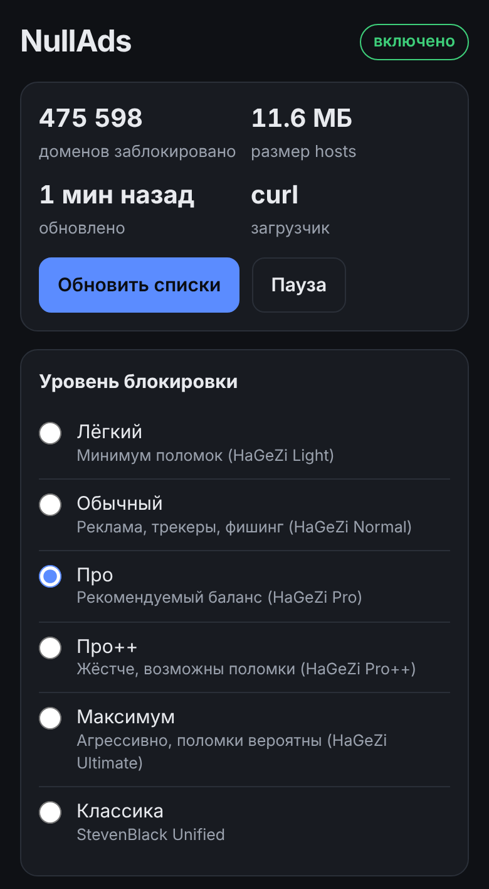

# NullAds — Android systemless ad blocker

[Русский](README.md) · [Download releases](https://github.com/cfifBOOM/nullads/releases)

NullAds is a free, open-source hosts-based ad, tracker and telemetry blocker for rooted Android devices. It supports Magisk, KernelSU, SukiSU and APatch. The module downloads blocklists directly from their authors and builds a local hosts file without modifying the system partition.

<p align="center"></p>

## Features

- Five blocking levels based on [HaGeZi DNS Blocklists](https://github.com/hagezi/dns-blocklists), from Light to Ultimate, plus [StevenBlack Unified Hosts](https://github.com/StevenBlack/hosts).
- Optional lists for Xiaomi/HyperOS, TikTok and Samsung telemetry, gambling, adult content, social networks and fake news.
- Custom allowlists and blocklists, including wildcard domains.
- Apply changes without rebooting; pause or resume blocking from the command line.
- Configurable automatic updates (every seven days by default), mirror fallback and last-known-good copy when downloads fail.
- Control through the root manager WebUI, Action button or terminal.

## Installation

1. Download the module ZIP from [GitHub Releases](https://github.com/cfifBOOM/nullads/releases).
2. Install it using your root manager (Magisk, KernelSU, SukiSU or APatch).
3. Reboot your device.

The default blocking level is Pro. Recent KernelSU and SukiSU versions require a compatible mounting metamodule, such as Magic Mount, to replace system files.

## Usage

Run `su -c nullads` to open the menu. Other commands (run in a root shell):

```sh
nullads status
nullads update
nullads level pro
nullads extra add xiaomi
nullads allow example.com
nullads block example.com
nullads check example.com
nullads pause
nullads resume
nullads auto 7
nullads url add https://example.com/list.txt
```

Settings and custom lists are stored in `/data/adb/nullads` and survive module updates. See the [Russian README](README.md#использование) for additional options.

## How it works

NullAds extracts domain names and maps them to `0.0.0.0`. It does not act as a VPN or redirect traffic to remote servers through blocklist entries. Multiple domains are grouped per hosts line. Downloads use curl or wget, with mirror fallback.

## Limitations

Hosts-based blocking cannot reliably remove in-stream advertising served from the same domains as content, including YouTube and Spotify ads. Applications using their own DNS-over-HTTPS resolver may bypass the hosts file. Other modules replacing `/system/etc/hosts` can conflict with NullAds. Larger lists may increase lookup time.

## License and third-party sources

NullAds code is licensed under [MIT](LICENSE). HaGeZi (GPL-3.0) and StevenBlack (MIT) lists are downloaded directly on the device, not bundled or redistributed by NullAds. See [THIRD_PARTY.md](THIRD_PARTY.md) for credits and license details.

## Support development

NullAds is free. Donations are voluntary and support development of the module itself, including the downloader and WebUI.

[Donate via DonationAlerts](https://www.donationalerts.com/r/cfifboom)

Please also consider supporting the blocklist authors listed in [THIRD_PARTY.md](THIRD_PARTY.md).
