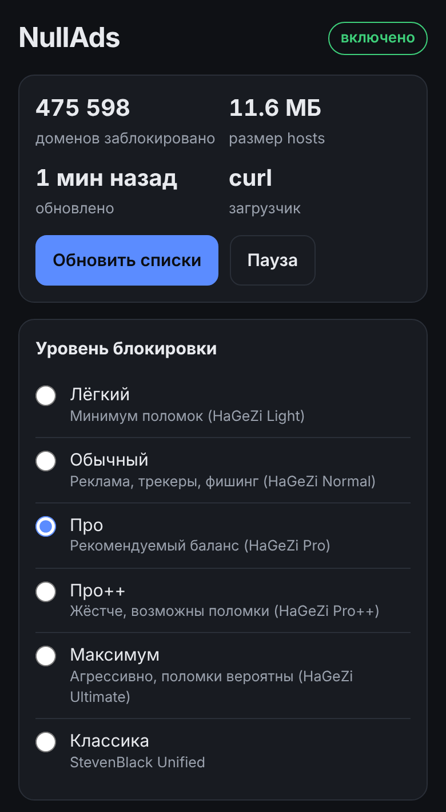

# NullAds — блокировщик рекламы для Android

[English documentation](README.en.md) · [Скачать модуль](https://github.com/cfifBOOM/nullads/releases)

**NullAds — free systemless ad blocker for Android (Magisk, KernelSU, SukiSU, APatch).**

Блокировка рекламы, трекеров и телеметрии на Android через `hosts`, для **KernelSU / SukiSU / APatch / Magisk**.
Модуль сам скачивает списки у авторов, собирает из них hosts и подменяет системный файл без изменения раздела `/system`.

<p align="center"></p>

## Возможности

- **Уровни блокировки** на списках [HaGeZi](https://github.com/hagezi/dns-blocklists): Лёгкий, Обычный, Про (по умолчанию), Про++, Максимум. Есть классический [StevenBlack Unified](https://github.com/StevenBlack/hosts).
- **Дополнительные списки**: телеметрия Xiaomi/HyperOS, TikTok, Samsung; ставки, 18+, соцсети, фейковые новости.
- **Белый и чёрный списки.** `*.example.com` разрешает домен со всеми поддоменами.
- **Применяется сразу**, без перезагрузки: hosts перезаписывается на месте.
- **Пауза** одной командой, **автообновление** раз в N дней.
- **Зеркала**: GitHub → cdn.jsdelivr.net → fastly.jsdelivr.net. Если всё недоступно, остаётся прошлая копия.
- **Управление**: команда `nullads` в терминале, WebUI в менеджере root, кнопка «Действие».

## Установка

1. Скачайте `NullAds-vX.Y.zip` из [Releases](../../releases).
2. Установите в менеджере root (KernelSU/SukiSU/APatch/Magisk) или командой:
   `su -c "ksud module install /sdcard/Download/NullAds-vX.Y.zip"`
3. Перезагрузите телефон.

При установке модуль сразу скачивает списки уровня «Про». Новым KernelSU и SukiSU для подмены
файлов нужен модуль-монтировщик (метамодуль), например Magic Mount.

## Использование

```
su -c nullads                  меню
nullads status                 состояние
nullads update                 скачать списки и применить
nullads level pro              уровень: light normal pro proplus ultimate steven
nullads extra add xiaomi       доп.: xiaomi tiktok samsung gambling nsfw social fakenews
nullads allow example.com      в белый список
nullads block example.com      в чёрный список
nullads check example.com      заблокирован ли домен
nullads pause | resume         выключить / включить
nullads auto 7 | off           автообновление
nullads url add https://…      свой список (hosts, домены или ||domain^)
```

Настройки, белый и чёрный списки лежат в `/data/adb/nullads` и переживают обновление модуля.

## Как устроено

- **Только блокировка.** Из любого списка берутся только имена доменов, и все пишутся как `0.0.0.0`.
  Подменённый или испорченный список может заблокировать сайт, но не перенаправить ваш трафик.
- **Быстрее обычного hosts.** Резолвер Android читает hosts целиком на каждый DNS-запрос.
  NullAds пишет по 9 доменов в строку: так поиск идёт почти вдвое быстрее.
- **Бережно к источникам.** Скачивание с честным User-Agent `NullAds/<версия>`,
  автообновление по умолчанию раз в 7 дней.
- **Загрузка**: системный `curl`, затем `curl` из Termux, затем `wget` из busybox менеджера.

## Ограничения

- DNS-блокировка не убирает рекламу внутри YouTube, Spotify и подобных приложений:
  она идёт с тех же доменов, что и сам контент.
- Браузеры с включённым «безопасным DNS» (DoH) обходят hosts.
- Другие модули, которые тоже подменяют `/system/etc/hosts`, конфликтуют с NullAds.
- Чем больше список, тем дольше каждый DNS-запрос. Если заметны задержки, выберите «Обычный» или «Лёгкий».

## Лицензии

Код NullAds распространяется под [MIT](LICENSE).

**Списки блокировки в проект не входят и не распространяются.** Модуль скачивает их на вашем
устройстве напрямую у авторов: HaGeZi — GPL-3.0, StevenBlack — MIT. Подробности и условия авторов —
в [THIRD_PARTY.md](THIRD_PARTY.md). Используя списки, вы принимаете их условия.

## Поддержать

Донаты идут на развитие кода NullAds: загрузчика, WebUI и т.п.
Сами списки делают их авторы, поддержите и их, ссылки — в [THIRD_PARTY.md](THIRD_PARTY.md#поддержите-авторов-списков).

**[Поддержать через DonationAlerts](https://www.donationalerts.com/r/cfifboom)**

---

### English

[Full English documentation and installation guide](README.en.md).

NullAds is a systemless hosts-based ad/tracker blocker module for KernelSU, SukiSU, APatch and Magisk.
It downloads [HaGeZi](https://github.com/hagezi/dns-blocklists) (GPL-3.0) and [StevenBlack](https://github.com/StevenBlack/hosts) (MIT)
lists directly from their authors on the device and builds `/system/etc/hosts` locally.
No blocklist data is included in or redistributed by this project. Code is MIT-licensed.
Manage it with `su -c nullads`, the module WebUI or the Action button.
